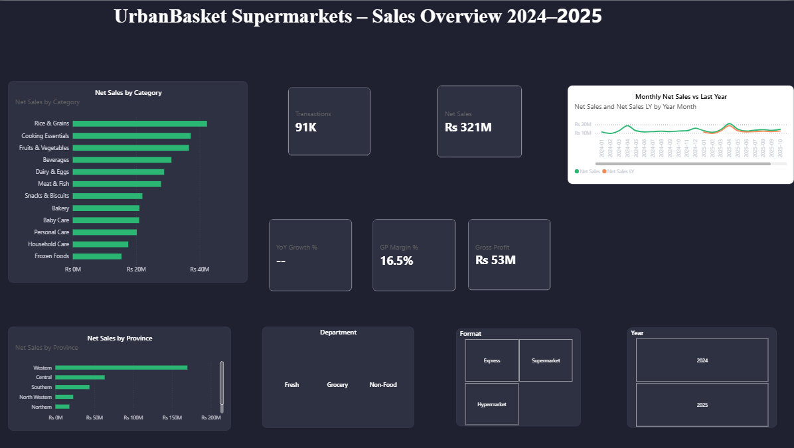
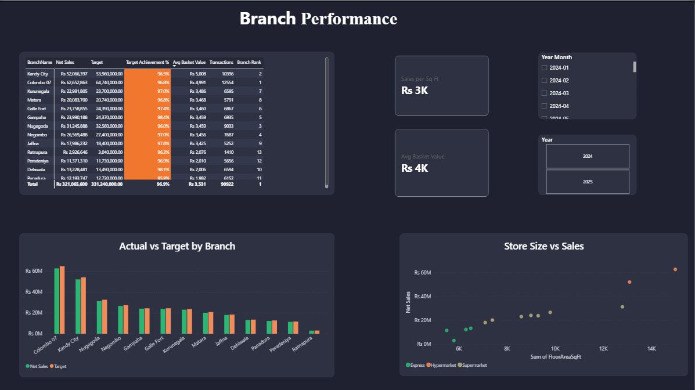
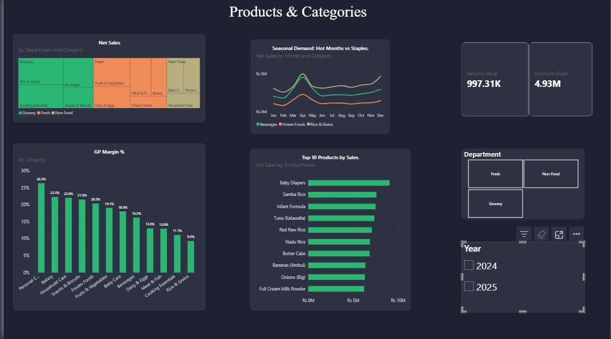
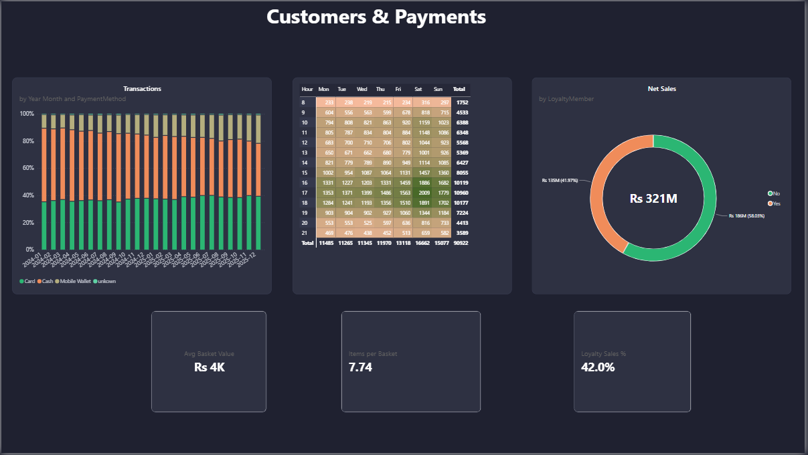
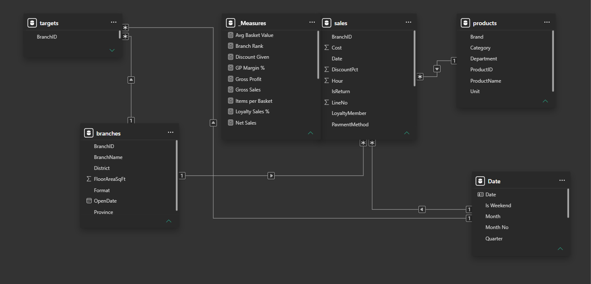

# 🛒 UrbanBasket Supermarket Sales Dashboard (Power BI)

An interactive **Power BI** dashboard analysing two years (2024–2025) of retail sales for **UrbanBasket Supermarkets**, a fictional chain with 13 branches across Sri Lanka.

> All data is **simulated** (see [`src/generate_data.py`](src/generate_data.py)). The simulation follows realistic patterns: Sinhala & Tamil New Year and Christmas peaks, weekend and salary-day effects, a shift from cash to digital payments, and a new branch opening.

**Tools:** Power BI · Power Query · DAX · Data modelling (star schema) · Python (data generation)

## Dashboard

### 1. Executive Overview


### 2. Branch Performance


### 3. Products & Categories


### 4. Customers & Payments


## Key insights

| # | Insight | Evidence |
|---|---------|----------|
| 1 | **Sinhala & Tamil New Year drives the biggest month** | April sales are **1.49×** the monthly average; December (Christmas) is **1.28×**; February is the quietest at **0.73×** |
| 2 | **Strong growth in 2025** | Net sales grew **15.2%** year-on-year: **10.6%** more transactions plus price increases |
| 3 | **Two hypermarkets dominate** | Colombo 07 (**Rs 62.7M**) and Kandy City (**Rs 52.1M**) bring in over a third of all sales |
| 4 | **Targets are slightly too ambitious** | Branches hit **95.9%–98.4%** of target overall, and met their monthly target in only **31%** of months. Panadura is lowest; Gampaha is highest |
| 5 | **Customers are moving away from cash** | Cash fell from **51.0% → 43.4%** of transactions (2024 → 2025), while mobile wallets grew **12.5% → 17.8%** |
| 6 | **Weekend evenings are the peak** | Saturday is the busiest day (**16.7k** transactions vs ~11.3k on a Tuesday), and **5–6 pm** is the busiest hour, so roster more cashiers then |
| 7 | **Best sellers are not the most profitable** | Rice & Grains is the #1 category by sales but has the lowest margin (**9.3%**); Personal Care earns the most (**26.3%**) |
| 8 | **Loyalty members matter** | **42%** of net sales come from loyalty-card customers |

Overall: **Rs 321.1M** net sales from **90,922** transactions, with a **16.5%** gross margin.

## Data model

Star schema: `Sales` (448k rows) and `Targets` (monthly) fact tables, linked to `Date`, `Products` and `Branches` dimension tables.



## Data cleaning (Power Query)

- Removed 60 duplicate transaction lines
- Flagged 1,345 returns (negative quantities) and kept them in Net Sales
- Replaced 896 blank payment methods with "Unknown"
- Standardised inconsistent category names (trimmed spaces, fixed capitalisation)

## Key DAX measures

```DAX
Net Sales LY = CALCULATE ( [Net Sales], SAMEPERIODLASTYEAR ( 'Date'[Date] ) )
YoY Growth % = DIVIDE ( [Net Sales] - [Net Sales LY], [Net Sales LY] )
Target Achievement % = DIVIDE ( [Net Sales], [Target] )
Avg Basket Value = DIVIDE ( [Net Sales], [Transactions] )
```

## Files

```
UrbanBasket_Sales_Dashboard.pbix   Power BI report
data/                              sales, products, branches, targets (CSV)
src/generate_data.py               Generates the simulated dataset
images/                            Dashboard screenshots
GUIDE.md                           Step-by-step build guide
```

---
Built by **Pramuditha Weerathunga**
